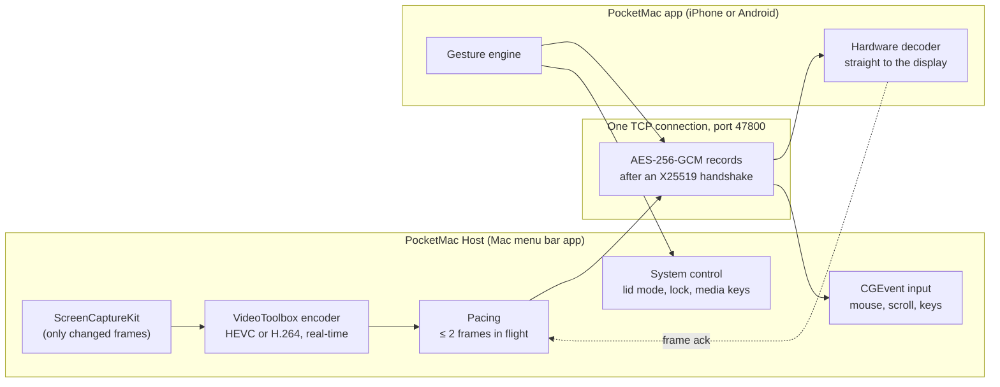
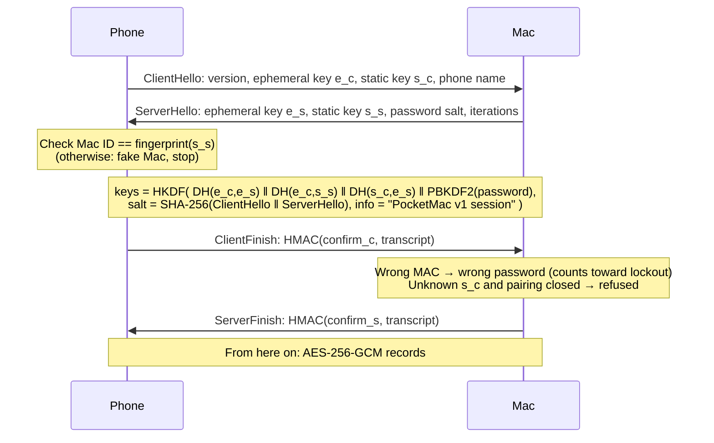

# How PocketMac works

A tour for anyone who wants to understand, check or improve PocketMac. For setup and everyday use, see the [README](../README.md).

- [The big picture](#the-big-picture)
- [Finding the Mac](#finding-the-mac)
- [Logging in (the handshake)](#logging-in-the-handshake)
- [Security](#security)
- [Messages](#messages)
- [Video: from the Mac's screen to the phone](#video-from-the-macs-screen-to-the-phone)
- [Input: from the phone to the Mac](#input-from-the-phone-to-the-mac)
- [Lid closed, privacy and battery](#lid-closed-privacy-and-battery)
- [Measured performance](#measured-performance)
- [How it's tested](#how-its-tested)
- [Code map](#code-map)

---

## The big picture



There is **no server**. The phone opens one TCP connection straight to the Mac. Everything after the first four handshake messages is encrypted.

| Part | Language | Notes |
|---|---|---|
| `Host/` | Swift (AppKit + SwiftUI) | Built with the Command Line Tools only (`tools/build-host.sh`), no Xcode project |
| `iOS/` | Swift (SwiftUI + UIKit) | XcodeGen project (`iOS/project.yml`), built in GitHub Actions |
| `android/` | Kotlin (Jetpack Compose) | Gradle, built in GitHub Actions |
| `Shared/` | Swift | Protocol, crypto and networking. Used by the Mac and iPhone apps; the Android app has a Kotlin port that is checked byte for byte against it |

## Finding the Mac

The phone tries **every path at once** and keeps the first one that completes a TCP connection ("happy eyeballs", `Shared/Net.swift` and `ConnectionRacer` in the Android app):

1. **Bonjour** on the local network: the Mac advertises `_pocketmac._tcp` with a TXT record `id=<Mac ID>`. The phone matches the ID it saved.
2. **Apple peer-to-peer Wi-Fi (AWDL)**: iPhone only. Works near the Mac with no router at all.
3. The **internet address** saved for the Mac: a Tailscale name or `100.x.y.z` address, a public IPv6 address, or a forwarded port.

Away from home, two devices behind carrier NAT can't find each other with zero infrastructure: something has to exchange their addresses. That's why the README recommends [Tailscale](https://tailscale.com) (WireGuard mesh, direct connections, its coordination server only sees public keys and addresses) or self-hosted [Headscale](https://github.com/juanfont/headscale). PocketMac's own encryption runs on top either way.

TCP is tuned for interactive use: `TCP_NODELAY`, keep-alive, the low-latency traffic class, and regular pings so a dead connection is noticed within seconds. When the network changes (Wi-Fi ↔ mobile data) the app reconnects with back-off.

## Logging in (the handshake)

Each side has a long-term **X25519 key**. The Mac's public key is its identity: the **Mac ID** (e.g. `K7QM-4XPA-9TZC`) is the first 60 bits of SHA-256 of that key, written in Crockford base32. The phone makes its own key on first launch and keeps it in the Keychain / Android Keystore.



HKDF-SHA256 gives 128 bytes: phone→Mac key, Mac→phone key, and two confirmation keys. The password is normalised to Unicode NFC first, then stretched with PBKDF2-HMAC-SHA256 (210,000 iterations, salt chosen by the Mac).

Handshake messages start with the magic `PKM` and a type byte (`0x01` ClientHello … `0x04` ServerFinish, `0x05` error). An error carries a code (wrong password, not paired, locked out + seconds, version mismatch, no password set, protocol error).

## Security

| Threat | What stops it |
|---|---|
| Someone listening on the network (café Wi-Fi, carrier) | Everything after the handshake is AES-256-GCM. Keys come from ephemeral X25519, so recorded traffic stays safe even if a long-term key leaks later (forward secrecy). |
| A fake "Mac" collecting passwords | The phone checks that the Mac's static key matches the Mac ID it saved. A fake doesn't have the private key, so it can't compute DH(e_c, s_s) or ServerFinish, and never sees anything it could brute-force offline. |
| Password guessing against the Mac | Only paired phones may even try. After 5 wrong passwords, logins are locked for 30 s, doubling with each further wrong try (up to 1 hour). Guesses are online-only. |
| A stranger's phone with the right password | Refused: only paired phones are accepted. A new phone can pair only during a 5-minute window opened on the Mac itself. |
| Replayed, reordered or modified packets | Each direction has its own key and a counter nonce (4 zero bytes + 8-byte big-endian counter). Anything out of order fails to decrypt and closes the connection. |
| The Mac's password file being stolen | The Mac stores only the PBKDF2 output and salt, never the password. |
| A stolen phone | The saved login is encrypted by the phone's secure hardware (iOS Keychain, Android Keystore AES-GCM), unlocked with Face ID / fingerprint / passcode. App data is excluded from backups. |
| Someone looking at the Mac while you're away | While a phone is connected, the Mac's screen is dark (privacy mode). When the phone leaves, the Mac locks. |

Known limits: the Mac app is not notarized (macOS shows a warning on first launch), and the phone must trust the Mac ID it was given, so get it from the Mac itself (menu bar → *ID … (click to copy)*).

Report vulnerabilities privately: see [SECURITY.md](../SECURITY.md).

## Messages

After the handshake, every message is one encrypted record: a 4-byte big-endian length, then the AES-GCM ciphertext and 16-byte tag. Inside, the first byte is the message type. All numbers are big-endian (`Shared/Wire.swift`, Android `proto/Wire.kt`).

**Phone → Mac** (`ClientMessage`)

| Type | Message | Content |
|---|---|---|
| `0x20` | startStream | codec, quality, fps, phone screen size, lid-closed fit |
| `0x21` | updateSettings | same, while streaming |
| `0x22` | frameAck | frame ID (flow control) |
| `0x23` | requestKeyframe | after a decoder error |
| `0x24` | setPaused | app in background |
| `0x30`–`0x33` | mouseMove, mouseButton, scroll, key | normalised coordinates (0…1), button, clicks, modifier flags, Mac key codes |
| `0x34` | text | typed text (any language, sent as text, not key codes) |
| `0x35` | action | quick action: lock, sleep display, Mission Control, Spotlight, ⌘Tab, show desktop, volume, media keys, screenshot, Force Quit, lid mode on/off, sleep, wake |
| `0x36` | clipboard | phone → Mac clipboard |
| `0x37` | ping | timestamp for the round-trip time |

**Mac → phone** (`ServerMessage`)

| Type | Message | Content |
|---|---|---|
| `0x10` | videoFormat | codec, size, parameter sets (VPS/SPS/PPS) |
| `0x11` | videoFrame | frame ID, keyframe flag, capture time, AVCC/HVCC data |
| `0x12` | status | Mac name, battery, charging, lid closed, permissions… |
| `0x13` | clipboard | Mac → phone clipboard |
| `0x14` | pong | ping reply |
| `0x15` | cursor | pointer position (for the phone's pointer ring) |
| `0x16` | notice | a message to show (e.g. "Screen Recording is off") |

Unknown message types are ignored, so newer Macs and older phones (or the other way round) keep working. A breaking change bumps `Handshake.version`.

## Video: from the Mac's screen to the phone

**On the Mac** (`Host/ScreenStreamer.swift`, `Host/VideoEncoder.swift`):

1. **ScreenCaptureKit** delivers a frame only when something on screen changed. A still screen costs ~0 CPU and sends 0 bytes.
2. **VideoToolbox** encodes in hardware (the media engine, not the CPU cores): HEVC Main or H.264 High, real-time mode, no B-frames. The size is capped by the chosen quality (1280 / 1920 / 2940 px wide).
3. **Pacing**: at most 2 frames may be unacknowledged. A newer frame replaces the queued one instead of piling up, so a slow network means fewer frames, never growing lag. The bitrate adapts to the measured queueing delay (AIMD).
4. **Re-sharpen**: when motion stops, the last frame is encoded again at higher quality up to 3 times, so text becomes crisp even on mobile data.
5. **Smart frame rate**: full rate while you touch or type; 10 fps when only small things animate by themselves (a spinner, a blinking caret).

**On the iPhone** (`iOS/PocketMac/RemoteSession.swift`, `Shared/VideoCM.swift`): frames are wrapped as `CMSampleBuffer`s and given to an `AVSampleBufferDisplayLayer`, which decodes in hardware and displays in one step. No pixel copies.

**On Android** (`android/.../video/VideoDecoder.kt`): `MediaCodec` in asynchronous mode on its own thread, decoding straight onto a `SurfaceView` (the display hardware scales it). AVCC is turned into Annex-B in place, `KEY_LOW_LATENCY` is used when the decoder supports it, buffers are pooled (no garbage-collection stutter), the display is asked to match the stream's frame rate on 90/120 Hz screens, and if HEVC keeps failing the app switches to H.264 by itself. A watchdog asks for a new keyframe if the picture stalls.

## Input: from the phone to the Mac

One **gesture engine** per app (`iOS/PocketMac/GestureEngine.swift`, `android/.../remote/GestureEngine.kt`) looks at the raw touches and decides what each touch means, so gestures never fight each other: tap, double tap, drag, long press, two-finger scroll with momentum, pinch to zoom, three-finger swipes and taps (the table is in the README). On Android, touches are delivered unbatched (`requestUnbufferedDispatch`) for the lowest delay.

Coordinates are sent as fractions of the screen (0…1), so the Mac maps them onto whatever display is being streamed. The Mac posts them as **CGEvents** (`Host/InputInjector.swift`), which needs the Accessibility permission.

Typing is sent as **text**, not key codes, so every keyboard language works, including Hindi and emoji. Special keys and shortcuts are sent as Mac key codes with modifier flags (`KeyMap` on Android).

## Lid closed, privacy and battery

- **Lid closed** (`Host/SystemControl.swift`): `pmset -a disablesleep 1` keeps the Mac running. When the lid closes, PocketMac adds a **virtual display** (CGVirtualDisplay) shaped like your phone's screen, and streams that one. It only stays on while PocketMac Host runs: quitting turns it off. The optional **helper** is a sudoers rule that allows only `pmset -a disablesleep 0/1` without a password, so the phone can switch it and the battery guard can turn it off at 15%.
- **Privacy mode** (`Host/PrivacyMode.swift`): when a phone connects, the Mac's backlight goes off using the normal brightness keys; the desktop keeps running for the phone. When the phone leaves, the Mac locks (⌃⌘Q). Tapping ✕ locks at once; an unexpected drop waits a short grace period so a quick reconnect doesn't lock you out.
- **Battery**: an idle Mac app only listens on a socket; when a phone is connected, a still screen sends nothing. The phone app drops to battery-saver quality and 30 fps in Low Power Mode / Battery Saver.

## Measured performance

MacBook Air M2, PocketMac Host:

**Idle (no phone connected)**, 60 s average:

| Version | CPU | Wake-ups | Energy impact | Memory |
|---|---|---|---|---|
| first version | 2.42 % | 4.4 /s | 2.43 | 33 MB |
| **now** | **0.02 %** | **0–0.1 /s** | **0.02** | **13 MB** |

**Connected, moving test picture, nobody touching** (30 s, two rounds each):

| | Before smart frame rate | After |
|---|---|---|
| CPU | 4.1–4.5 % | 2.7–2.8 % |
| Wake-ups | 5.9–10.3 /s | 3.1–3.2 /s |
| Frames sent | 651 | 227 |
| Data | 123 kbps | 29 kbps |

A busy real screen (big changes, ~30 fps) measured 4.9 % CPU.

## How it's tested

| What | How | Where |
|---|---|---|
| Login, pairing rules, fake Mac, wrong password, lockout, both codecs, privacy mode (dry run) | 18 end-to-end checks against a throw-away **test host** on localhost | `tools/run-tests.sh`, GitHub Actions *Build Mac app* |
| The Android protocol matches the Swift one **byte for byte** | Known-answer vectors made by the Swift code (handshake, crypto, every message), checked by JUnit | `tools/make-vectors.sh` → `ProtocolVectorsTest` |
| Real Mac video decodes on Android | HEVC and H.264 recorded from the test host, decoded on an Android emulator | `DecoderTest` |
| Every Android screen works | Compose UI test walks through every screen and saves screenshots | `ScreenshotTest` |
| The iPhone app builds | Unsigned `.ipa` built on every change; type-check on a Mac without Xcode | `build-ios.yml`, `tools/check-ios.sh` |
| iPhone + Mac screenshots | iOS Simulator connected to a test host showing the demo desktop | `screenshots.yml` |

The **test host** is the real Mac app with environment variables: `POCKETMAC_TEST_PATTERN=1` (moving test picture; `=desktop` for the demo desktop) instead of screen capture, `POCKETMAC_LOOPBACK=1`, `POCKETMAC_HEADLESS=1`, its own `POCKETMAC_CONFIG_DIR` and `POCKETMAC_PORT`, and `POCKETMAC_PRIVACY_DRYRUN=1` so it never darkens or locks the Mac it runs on. `tools/pmtest` is a command-line phone: it logs in, streams, decodes and reports.

## Code map

```
Shared/
  Wire.swift         big-endian reader / writer
  Crypto.swift       X25519, PBKDF2, HKDF, Mac ID, AES-GCM records (CipherState)
  Handshake.swift    the login protocol, both sides
  Messages.swift     every message, settings, quick actions
  Net.swift          framed TCP connection, endpoint racing, ClientCore
  VideoCM.swift      compressed frames → CoreMedia sample buffers
Host/
  AppMain.swift      menu bar icon, settings window, start-up
  HostServer.swift   listener, Bonjour, pairing, lockout, one session at a time
  ScreenStreamer.swift / VideoEncoder.swift   capture → encode → pace
  InputInjector.swift  CGEvents for mouse, scroll and keys
  SystemControl.swift  lid mode, virtual display, quick actions, helper
  PrivacyMode.swift    dark screen while connected, lock on leave
  DemoDesktop.swift    the made-up desktop for screenshots
iOS/PocketMac/
  HomeView.swift, SettingsView.swift   saved Macs, nearby, settings
  RemoteSession.swift   connection + decoder + reconnect
  RemoteScreen.swift, RemoteViewController.swift, GestureEngine.swift, Keyboard.swift
android/app/src/main/java/com/nareshchoudhary/pocketmac/
  proto/    Kotlin port of Shared/ (Wire, X25519, Crypto, Handshake, Messages, ClientCore)
  video/    MediaCodec decoder
  remote/   RemoteView (SurfaceView, zoom, keyboard), GestureEngine, KeyMap
  ui/       Compose screens: Home, Add Mac, Settings, Remote
  data/     saved Macs and settings, Keystore vault
tools/
  build-host.sh, make-dmg.sh, run-tests.sh, test-host.sh, pmtest/, vectors/, make-vectors.sh, check-ios.sh
```
